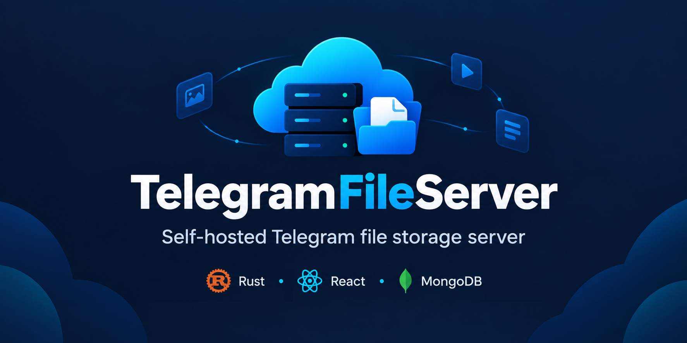

<p align="center">
  
</p>

<p align="center">
  <strong>Your files, in Telegram. Served as your own cloud drive.</strong><br>
  A self-hosted file server that keeps your data in Telegram and streams it back to you
  through a browser UI — free-ish storage, no third-party cloud account, multi-user.
</p>

<p align="center">
  <a href="https://github.com/The-KLYRO/TelegramFileServer"></a>
  <a href="https://telegram.org"></a>
  <a href="LICENSE"></a>
</p>

## Purpose

TelegramFileServer stores your files in Telegram chats via bots and serves them back to you
as if they were your own cloud drive. The project is built around a Rust server and a
Telegram transfer engine, with MongoDB for metadata and a browser-based file interface.

It gives Telegram storage a proper file-server workflow: a web UI, per-user ownership,
folder browsing, search, resumable downloads, direct links, and upload/download operations that
are designed to behave like a personal cloud drive instead of a bot chat log.

## Structure

```
TelegramFileServer/
├── apps/                      # Application shells
│   └── fileServerApp/         # Cross-platform app shell (planned)
├── crates/                    # Rust workspace members
│   ├── telegram/              # Telegram transfer engine
│   ├── api/                   # HTTP API layer
│   ├── config/                # Setup config + encryption
│   ├── db/                    # MongoDB-backed storage
│   ├── server/                # Setup wizard server
│   ├── app-core/              # Shared domain logic (planned)
│   ├── auth/                  # Auth layer (planned)
│   └── jobs/                  # Background jobs (planned)
├── tests/                     # Integration tests
├── assets/
│   └── social-card.png        # README hero image
├── ROADMAP.md                 # Product roadmap
├── README.md                  # Project overview
└── LICENSE                    # MIT
```

The active implementation is centered on the Rust workspace. `crates/telegram`, `crates/config`,
`crates/db`, and `crates/api` contain working code today; `crates/server` is the setup flow,
while the remaining areas are still placeholders or planned expansions.

## Features

- Telegram-backed storage for uploaded files and media
- Resumable downloads with ranged HTTP streaming
- Direct links for download and playable media
- Per-user access and ownership flows
- Browser-based file explorer and gallery-style access
- MongoDB-backed metadata and folder structure
- Setup wizard for encrypted configuration and Telegram account onboarding
- SSE-based events for progress and status updates
- Built around a reusable `TelegramClient` transport abstraction

## Quickstart

```bash
git clone https://github.com/The-KLYRO/TelegramFileServer.git
cd TelegramFileServer
git checkout v2
cargo build --workspace
cargo run -p tfs
```

The wizard serves on `http://127.0.0.1:8090` by default, or on the port configured through
`PORT`. It collects the MongoDB connection details and stores encrypted configuration next to the
binary, while the app data is kept in the platform data directory.

## Configuration

The v2 setup flow is wizard-driven rather than `.env`-driven. It asks for the MongoDB URI,
Telegram account details, and the app configuration needed to initialize the service securely.

| Setting | Description | Required |
|---|---|---|
| MongoDB URI | MongoDB connection string for metadata and file indexing | Yes |
| Telegram account data | Telegram credentials used to claim the bot and initialize the client | Yes |
| Setup password | Wizard password stored in local app data | Yes |
| `PORT` | Local web server port (default `8090`) | No |

**Multiple bot support.** The runtime is designed to work with Telegram token setups and
multi-bot workload distribution, while preserving the same server-side file flow.

## Usage

After setup, open the web interface and sign in through the configured flow, then browse files,
search the catalog, upload content, preview media, and share direct links.

| Route | Purpose |
|---|---|
| `/healthz` | Liveness probe |
| `/` | Web UI |
| `/dl/{file_name}` | Force download |
| `/watch/{file_name}` | Inline playback |
| `/files/thumbnail/{file_id}` | Thumbnail image |
| `/system/bots/info`, `/system/bots/workloads` | Bot and workload details |
| `/docs` | API docs |

Resume works through ranged HTTP support:

```bash
curl -C - -o video.mp4 http://localhost:8090/dl/video.mp4
```

### If something goes wrong

| Symptom | Likely cause and fix |
|---|---|
| UI not loading | Check the MongoDB connection and the setup wizard state |
| Bot actions fail | Re-run setup and confirm Telegram credentials and bot claim state |
| Uploads do not land | Verify Telegram client state and bot workload configuration |
| Port already in use | Change `PORT` before running the server |
| Transfer operations fail | Validate the live Telegram scenario checklist in the engine docs |

## Shortcuts

| Command | Does |
|---|---|
| `cargo build --workspace` | Build every workspace member |
| `cargo test --workspace` | Run all tests |
| `cargo clippy --workspace` | Lint the workspace |
| `cargo fmt --all` | Format the Rust code |

## Project status

The v2 implementation is the active mainline build. The core transfer engine, setup flow,
HTTP API, Mongo-backed VFS, and browser UI are already connected end-to-end, with the remaining
work focused on final live Telegram validation and a few advanced feature gaps.

| Piece | State |
|---|---|
| Telegram transfer engine | ✅ Implemented |
| Upload / download / ranged streaming / cancellation / retry | ✅ Implemented |
| Setup wizard + encrypted config | ✅ Implemented |
| HTTP API + session auth + SSE events | ✅ Implemented |
| Mongo-backed VFS + media serving | ✅ Implemented |
| Web UI integration | ✅ Implemented |
| Live Telegram validation | ⏳ Final validation pending |
| Notes compose/edit, forward flows, phone-upload indexing | ⏳ Not yet supported |
| `crates/auth`, `crates/app-core`, `crates/jobs`, `apps/fileServerApp`, `tests/` | ⏳ Placeholders |

- [`crates/telegram/README.md`](crates/telegram/README.md) — engine documentation
- [`crates/telegram/POC_RESULTS.md`](crates/telegram/POC_RESULTS.md) — live-scenario checklist
- [`ROADMAP.md`](ROADMAP.md) — product roadmap

## Architecture

The application is layered around a Rust workspace with a transport abstraction at the bottom.
The Telegram layer is isolated behind a `TelegramClient` trait, so the rest of the stack can
operate against a consistent upload/download API regardless of transport details.

```
  apps/fileServerApp (planned) ─┐
  crates/server ────────────────┼──► crates/api ──► crates/{db,config}
                                │
                                └──► crates/telegram   ← implemented today
```

`crates/telegram` is the foundation: it handles upload, download, ranged streaming,
cancellation, and retry logic. Above it, the server and API layers expose the browser-facing
file workflow, while MongoDB provides metadata and folder state.

## Tech Stack

- **Rust** — Grammers 0.10 (Telegram MTProto), Axum + tower-http, MongoDB driver 3.0,
  Argon2 + XChaCha20-Poly1305, Tokio
- **Frontend app** — React, TypeScript, TailwindCSS, Vite, Tauri
- **Storage** — Telegram for file bytes, MongoDB for metadata and indexing

Exact versions are not pinned in the README; check the workspace `Cargo.toml` for current Rust
crate versions.

## Downloads

Nothing is published to a package registry yet — install from a clone.

- **v2** — `cargo build --workspace --release`
- **Desktop builds (Windows/Linux/macOS)** — [FileServerApp releases](https://github.com/pamod-madubashana/FileServerApp/releases)

The web UI and desktop app are maintained separately in
[FileServerApp](https://github.com/pamod-madubashana/FileServerApp).

## Links

| Resource | Link |
|---|---|
| Repository | [github.com/The-KLYRO/TelegramFileServer](https://github.com/The-KLYRO/TelegramFileServer) |
| v2 branch | [branch/v2](https://github.com/The-KLYRO/TelegramFileServer/tree/v2) |
| Web UI & desktop app | [FileServerApp](https://github.com/pamod-madubashana/FileServerApp) |
| Issues | [Issues](https://github.com/The-KLYRO/TelegramFileServer/issues) |
| Pull requests | [Pull requests](https://github.com/The-KLYRO/TelegramFileServer/pulls) |
| Contributing guide | [CONTRIBUTING.md](CONTRIBUTING.md) |
| Code of conduct | [CODE_OF_CONDUCT.md](CODE_OF_CONDUCT.md) |
| License | [LICENSE](LICENSE) |
| Roadmap | [ROADMAP.md](ROADMAP.md) |
| Telegram credentials | [my.telegram.org](https://my.telegram.org) · [@BotFather](https://t.me/BotFather) |

## Credits

**Pamod Madubashana** — sole author and maintainer of TelegramFileServer and FileServerApp
**lonami** - [Grammers](https://codeberg.org/Lonami/grammers) (MTProto)

## Contributing

Fork the project, work on a focused branch, keep one concern per commit with an imperative
message, verify with `cargo test --workspace && cargo clippy --workspace && cargo fmt --all`,
then open a pull request describing what changed and how you tested it. Please never commit
`.env`, bot tokens, API hashes, or database URIs.

## License

**MIT** — Copyright (c) 2025 P A M O D.

Full text: [LICENSE](LICENSE).